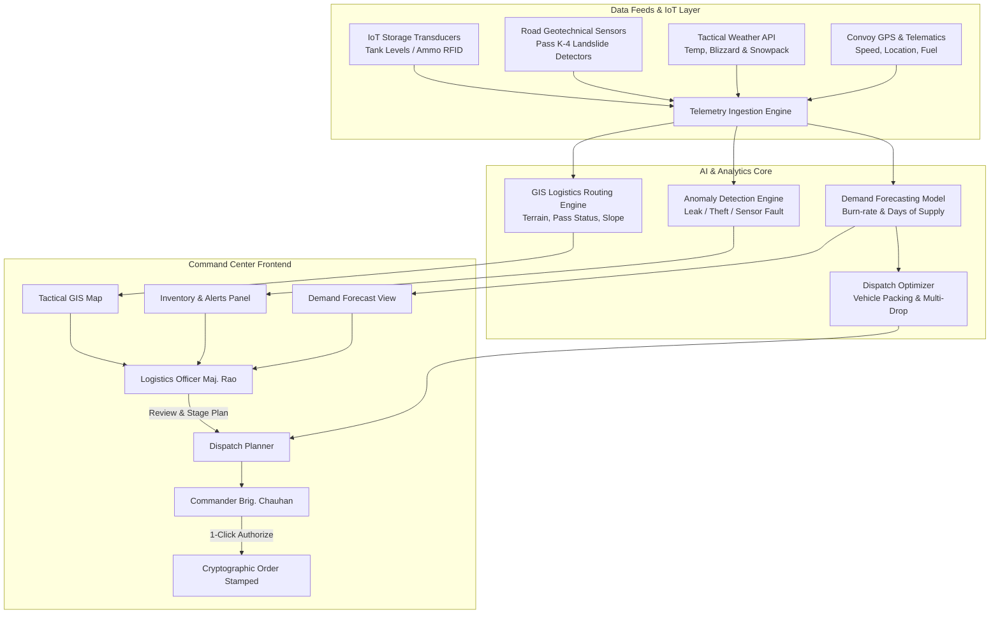
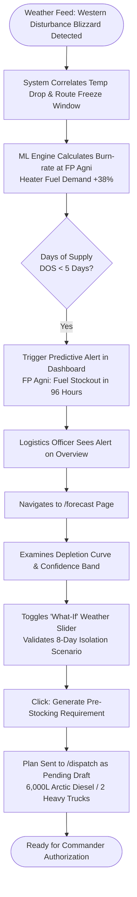
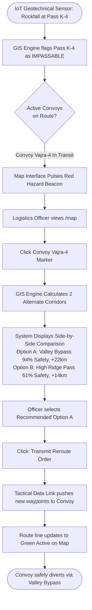
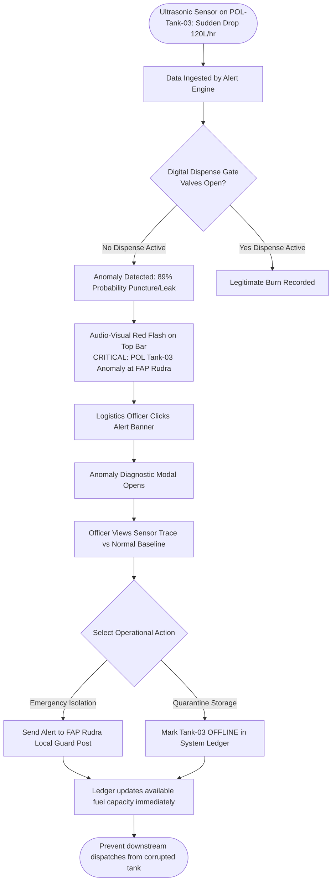
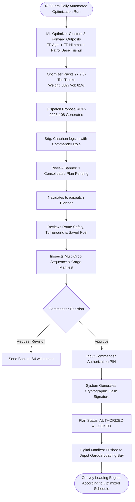

# RakshaLog — User Flows & Operational Sequence Diagrams
**System:** AI-Driven Forward Logistics & Supply Chain Command Center  
**Context:** Smart India Hackathon 2026 | Problem Statement ID: 26251  

---

## 1. High-Level System Architecture & Event Flow

This diagram illustrates how IoT sensor data, weather feeds, GIS terrain data, and AI/ML models combine to drive user decision-making across the platform.

---

## 2. Scenario A Flow: Predicting a Forward Stock Shortage

---

## 3. Scenario B Flow: Rerouting an Active Convoy Due to Pass Closure

---

## 4. Scenario C Flow: IoT Sensor Alert & Leak Isolation

---

## 5. Scenario D Flow: Commander Approval of Consolidated Dispatch Plan

